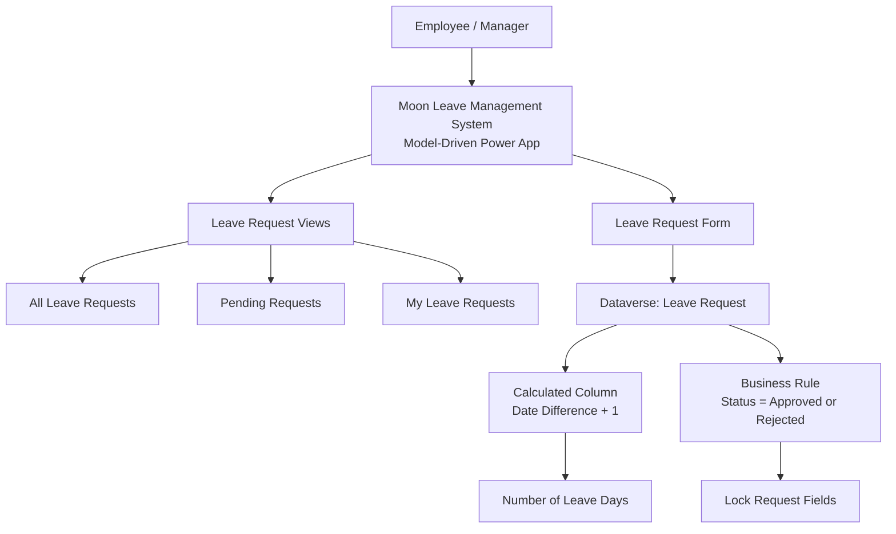
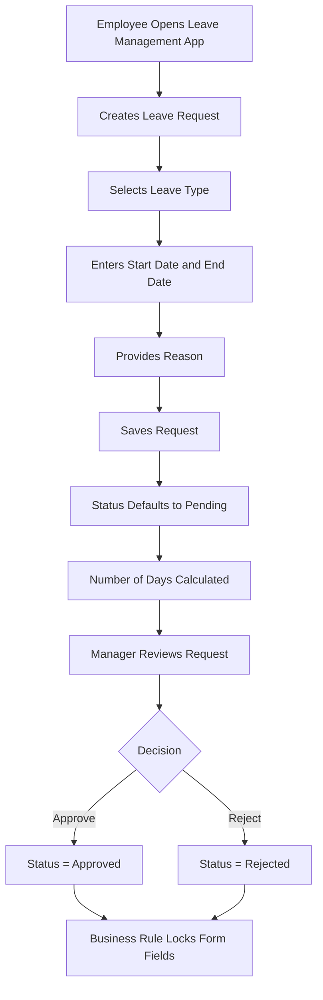

# Moon Leave Management System

**A Dataverse-powered employee leave management solution built with Microsoft Power Apps Model-Driven Apps.**

Moon Leave Management System provides a centralized application for employees to submit leave requests and for managers to review and update request decisions. Built on Microsoft Dataverse, the solution uses structured leave records, configurable views, business rules and calculated columns to streamline leave request management.
## App Gallery
Explore the main experiences available in Moon Leave Management App.


---

## Project Overview

The application digitizes the employee leave request process through a Model-Driven Power App.

Employees can create leave requests by selecting a leave type, entering the leave dates and providing a reason. Each new request is automatically assigned a **Pending** status. Managers can review requests, update the status and add comments. Once a request is marked as Approved or Rejected, a Dataverse business rule locks the form fields to prevent further changes.

### Key Objectives

- Provide a centralized platform for submitting and managing leave requests.
- Support multiple leave types.
- Capture leave start and end dates.
- Automatically calculate the number of leave days.
- Track request status through Pending, Approved and Rejected values.
- Provide views for all leave requests, pending requests and the current user's requests.
- Lock request records after an approval or rejection decision.

---

## Key Features

### 1. Leave Request Submission

Employees can create a leave request using the Model-Driven App.

The leave request form captures:

- Employee Name
- Leave Type
- Start Date
- End Date
- Number of Days
- Reason

### 2. Multiple Leave Types

The Leave Type column is configured as a Dataverse Choice field with the following options:

- Casual Leave
- Annual Leave
- Sick Leave
- Unpaid Leave
- Other

### 3. Request Status Tracking

Each new leave request is assigned a default status of **Pending**.

The Status Choice field contains:

- Pending
- Approved
- Rejected

Managers can update the status to record the decision on a request.

### 4. Automatic Leave-Day Calculation

The Number of Days column is configured as a Dataverse calculated column.

**Calculation:**

```text
Number of Days = Date Difference (End Date, Start Date) + 1
```

Adding one includes both the start date and end date in the leave duration.

The calculated value is populated automatically based on the selected dates.

### 5. Business Rule – Lock Approved or Rejected Requests

A Dataverse business rule controls record editing based on the request status.

**Condition:**

```text
Status = Approved OR Status = Rejected
```

**Action:**

- Lock the relevant fields on the leave request form.
- Prevent changes to the request details after a final decision has been recorded.

This helps preserve the submitted request details after approval or rejection.

### 6. Leave Request Views

Three views are configured to make leave records easier to access.

| View | Filter / behavior | Purpose |
|---|---|---|
| All Leave Requests | Displays leave request records | Provides an overall view of requests |
| Pending Requests | Status equals Pending | Shows requests awaiting a decision |
| My Leave Requests | Owner equals Current User | Shows records owned by the logged-in user |

The views display relevant columns, including employee name, leave type, start date, end date, number of days, status, reason and manager comments. The Start Date column is sorted from newest to oldest.

### 7. Manager Comments

The leave request table includes a multi-line text column for manager comments, allowing decision-related comments to be recorded with the request.

---

## Application Screens

Add screenshots of your actual Moon application to the `Screenshots` folder and update the image paths below.

| Screen | Description |
|---|---|
| Model-Driven App | Main application interface and navigation |
| All Leave Requests | Complete leave request list |
| Pending Requests | Requests awaiting a manager decision |
| My Leave Requests | Current user's leave records |
| Leave Request Form | Leave details and approval information |
| Approved Request | Form behavior after approval |
| Rejected Request | Form behavior after rejection |

### Screenshots

```md


```

---

## Dataverse Data Model

The application uses a Dataverse table named **Leave Request** to store employee leave records.

### Leave Request Table

| Column | Data Type / Configuration | Purpose |
|---|---|---|
| Employee Name | Primary name column | Identifies the employee submitting the request |
| Leave Type | Choice | Casual, Annual, Sick, Unpaid or Other |
| Start Date | Date and Time; required | First day of leave |
| End Date | Date and Time; required | Last day of leave |
| Number of Days | Whole Number; calculated | Calculates the leave duration |
| Reason | Multiple Lines of Text | Captures the reason for leave |
| Status | Choice; default Pending | Tracks the request decision |
| Manager Comments | Multiple Lines of Text | Stores manager comments |

### Status Values

| Status | Description |
|---|---|
| Pending | Newly submitted request awaiting a decision |
| Approved | Request approved by the manager |
| Rejected | Request rejected by the manager |

---

## Technical Architecture

### Technology Stack

| Technology | Usage |
|---|---|
| Microsoft Power Apps | Model-Driven App interface |
| Microsoft Dataverse | Leave request data storage |
| Dataverse Choice Columns | Leave type and request status |
| Dataverse Calculated Columns | Automatic leave-day calculation |
| Dataverse Business Rules | Locking form fields after approval or rejection |
| Dataverse Views | All, pending and current-user leave request lists |
| Power Platform Solutions | Organizing application components |

### Application Architecture



---

## Implementation Highlights

### Solution Setup
- Created a dedicated Power Platform solution.
- Created the Leave Request Dataverse table.
- Configured the primary employee name column.

### Column Configuration
- Added a Leave Type Choice column with five leave categories.
- Added required Start Date and End Date columns.
- Added a Number of Days column.
- Added Reason and Manager Comments multi-line text columns.
- Added a Status Choice column with Pending, Approved and Rejected options.
- Set Pending as the default status for new requests.

### Form Configuration
- Created and renamed the main form to **Leave Request Form**.
- Organized the form into Leave Details and Approval Details sections.
- Added employee, leave type, dates, number of days and reason to the Leave Details section.
- Added status and manager comments to the Approval Details section.

### Business Rule Configuration
- Created a business rule based on the Status column.
- Configured the condition to identify Approved or Rejected requests.
- Added lock actions for the relevant form fields.
- Validated and activated the business rule.

### View Configuration
- Created All Leave Requests.
- Created Pending Requests with a Pending status filter.
- Created My Leave Requests with an Owner equals Current User filter.
- Added the required columns and configured the date sorting.

### Model-Driven App Configuration
- Created the Leave Management Model-Driven App.
- Added the Leave Request table.
- Configured the application navigation.
- Added the All Leave Requests, Pending Requests and My Leave Requests views.
- Saved and published the application.

### Calculated Column Configuration
The Number of Days column was configured as a calculated column using the difference between the Start Date and End Date, plus one. The calculated column was then added to the main form and the relevant views.

---

## Process Flow



---

## Future Enhancements

- Power Automate flow to notify managers when a new leave request is submitted.
- Automated approval and rejection notifications to employees.
- Manager approval actions through an automated workflow.
- Power BI dashboard for leave trends and request reporting.
- Custom security roles to control employee and manager access.

---

## Project Summary

Moon Leave Management System demonstrates how Microsoft Power Platform can be used to digitize employee leave requests through a Dataverse-backed Model-Driven App. With structured leave records, multiple filtered views, calculated leave duration and status-based business rules, the solution provides a streamlined foundation for employee leave request management.
